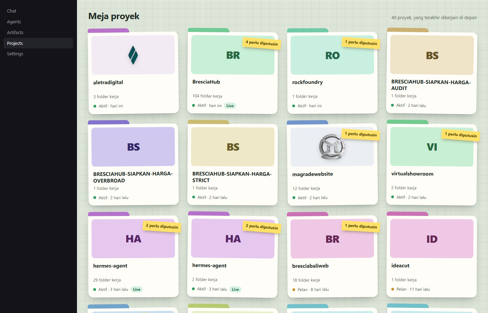
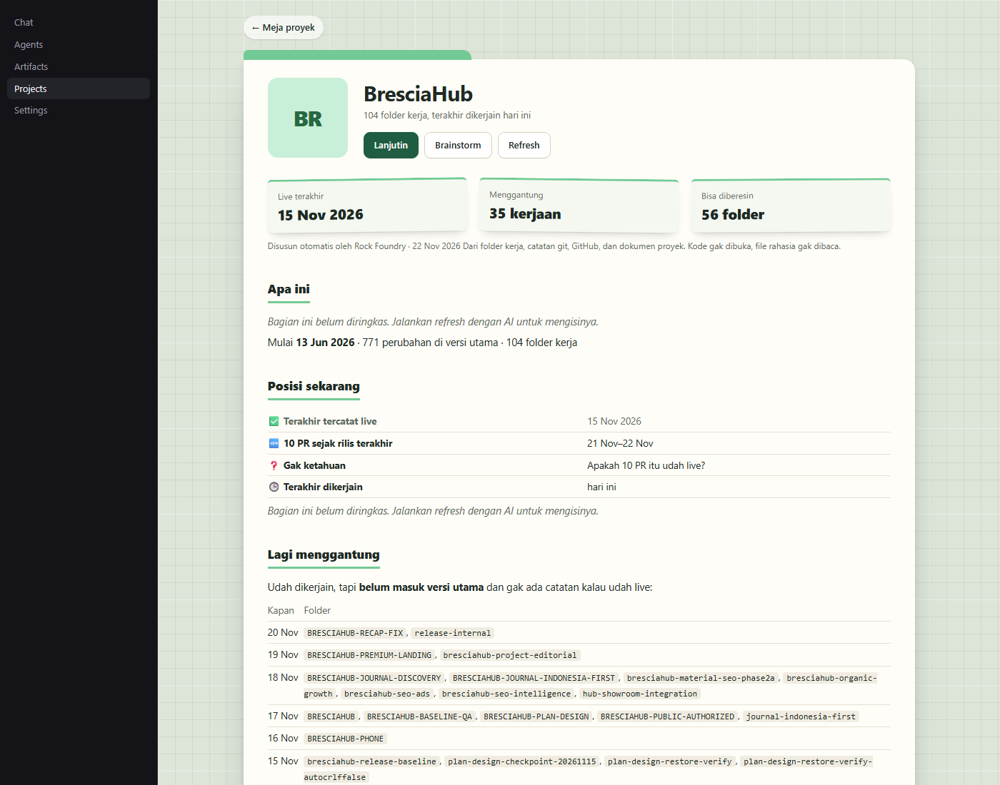

# Rock Foundry

**Buku proyek buat builder yang kerja bareng AI agent.**
Hermes (atau agent apa pun) yang ngerjain. Rock Foundry yang inget.

Kalau kerja pakai AI agent, tiap tugas dapet folder kerja, cabang, dan chat sendiri. Beberapa bulan
kemudian gak ada yang inget proyeknya mulai dari mana, apa yang udah live, apa yang setengah jadi,
atau apa yang gak boleh disentuh. Lu gak inget, agent di sesi berikutnya juga gak. Rock Foundry
membaca proyek lu (cuma baca) dan nyimpen satu **kartu proyek** berbahasa biasa untuk tiap proyek,
plus **galeri Projects** di Hermes Desktop.

> Cari v1 (Product Studio, WebMCP, Work OS)? Diarsipkan di tag
> [`legacy/product-studio`](https://github.com/ranggaoscar/rockfoundry/tree/legacy/product-studio).





<sub>Dirender dari kode plugin yang asli pakai data proyek beneran; jendela Hermes di sekitarnya disederhanakan.</sub>

## Isi kartu

- **Apa ini** dan mulai kapan
- **Posisi sekarang**: rilis terakhir yang tercatat, apa yang masuk sejak itu, apa yang belum ketahuan
- **Lagi menggantung**: kerjaan baru yang belum masuk versi utama
- **Rapihin folder**: berapa folder kerja, mana yang udah live dan aman diberesin
- **Jangan disentuh**: aturan dari dokumen proyek lu sendiri
- **Perlu lu putusin**, **peluang**, dan **riwayat singkat**
- **Catatan teknis buat agent** (dilipat)

## Cara kerja

1. **Fakta tanpa AI.** Mesin menjalankan perintah `git` (dan `gh` kalau ada) yang cuma membaca, di
   folder yang lu pilih. Semua folder kerja dari repo yang sama digabung jadi satu proyek.
2. **Cerita pakai AI, opsional dan di-cache.** Bagian "apa ini", "jangan disentuh", dan "peluang"
   ditulis model hanya kalau faktanya berubah.
3. **Kartu disimpan di luar proyek**, di `~/.rockfoundry/projects/<slug>/`.
4. **Hermes yang bikin kartu tetap segar.** Tiap sesi Hermes selesai, proyek yang disentuh di-scan ulang.

## Keamanan

- Gak pernah nulis di dalam proyek, gak pernah `git fetch` kecuali lu minta.
- Setting repo yang bisa bikin git menjalankan program dideteksi dan dilewati.
- File yang kelihatan rahasia (`.env`, kredensial, token, kunci) gak pernah dibuka.
- IP, kunci, dan token disensor di semua yang ditulis atau dikirim Rock Foundry.
- Dokumen proyek dikasih ke model sebagai data, bukan perintah.

## Pasang

Butuh Python 3.11+ dan git. Opsional: GitHub CLI (`gh`) yang udah login, dan Hermes Agent.

```bash
git clone https://github.com/ranggaoscar/rockfoundry.git
cp -r rockfoundry/hermes-plugin ~/.hermes/plugins/rockfoundry
hermes plugins enable rockfoundry
```

Buka Hermes Desktop, pilih **Projects** di sidebar, terus pilih folder proyek lu. Di chat Hermes:
`/proyek`, `/proyek <nama>`, `/proyek refresh`, `/proyek jadwal`.

Cuma CLI: lihat [README.md](README.md#install).

## Peta jalan

1. **Ingatan proyek, kartu, dan galeri** ← rilis ini
2. Kotak masuk proyek: masukan user, issue, PR kontributor, ditriase Hermes
3. Angka: jumlah user dan pemasukan
4. Peluang yang diurutkan pakai data nyata

## Lisensi

MIT
