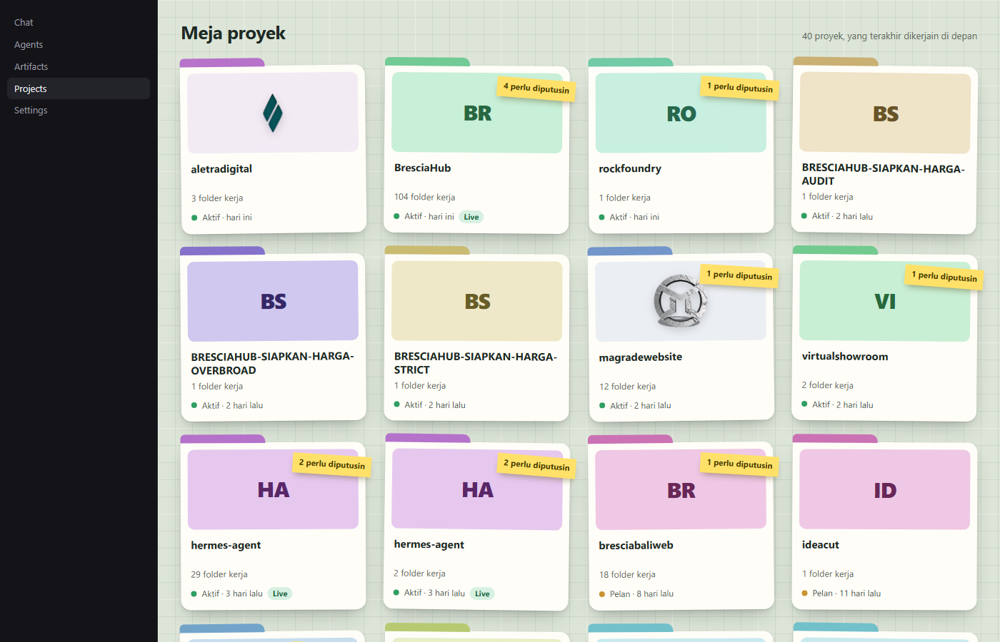
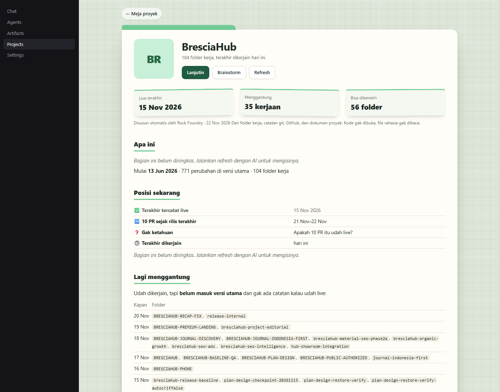

# Rock Foundry

**A project memory for builders who work with AI agents.**
Hermes (or any agent) does the work. Rock Foundry remembers it.

When you build with AI agents, every task gets its own work folder, branch and chat. After a few
months nobody remembers where a project started, what is live, what is half-done, or what must
never be touched — not you, and not the agent that opens the next session. Rock Foundry reads your
projects (read-only) and keeps one plain-language **project card** per project, plus a
**Projects gallery** inside Hermes Desktop.

> Looking for v1 (Product Studio, WebMCP, Work OS)? It is archived at the
> [`legacy/product-studio`](https://github.com/ranggaoscar/rockfoundry/tree/legacy/product-studio) tag.

Bahasa Indonesia: [README.id.md](README.id.md)





<sub>Rendered from the plugin's real code with real project data; the Hermes window around it is simplified.</sub>

## What a card tells you

- **What this is** and when it started
- **Where it stands**: last recorded release, what was merged since, what nobody knows yet
- **Hanging work**: things built recently that never reached the main version
- **Folder cleanup**: how many work folders exist, which are already live and safe to tidy
- **Do not touch**: rules taken from the project's own docs (`AGENTS.md`, `CLAUDE.md`, release notes)
- **Decisions waiting for you**, **opportunities**, and a **short history**
- A collapsed **technical block for agents**

Example from a real project with 104 agent work folders across two drives: "62 live, 55 safe to
tidy, 11 need a check first, 9 PRs merged since the last release — are they live?"

## How it works

1. **Facts without AI.** The engine runs read-only `git` (and optionally `gh`) commands over the
   folders you choose, and groups every worktree and clone of the same repo into one project.
2. **Narrative with AI, optional and cached.** "What is this", "do not touch" and "opportunities"
   are written by a model only when the facts change. Inside Hermes it uses the model you already
   use; from the CLI it can use `claude -p` with every tool disabled.
3. **Cards live outside your projects**, in `~/.rockfoundry/projects/<slug>/`.
4. **Hermes keeps them fresh.** After each Hermes session, the projects it touched are rescanned.

## Safety

- Never writes inside a project; never runs `git fetch` unless you ask (`--fetch`).
- Repo config that could make git run a program (custom filters, hooks, credential helpers) is
  detected, and that repo is skipped for status checks.
- Files that look like secrets (`.env`, `*credential*`, `*token*`, keys) are never opened.
- IP addresses, keys and tokens are masked in everything Rock Foundry writes or serves.
- Project docs reach models as data, never as instructions.

Details: [docs/safety.md](docs/safety.md).

## What the Hermes plugin does on your machine

So you know before installing:

- **Reads outside its own data.** It scans the project folders you choose (read-only) and writes
  only to `~/.rockfoundry/` (or `$ROCKFOUNDRY_HOME`).
- **Runs local commands.** `git` (read-only commands listed in [docs/safety.md](docs/safety.md)) and,
  unless you set `use_github = false` in `~/.rockfoundry/config.toml`, the GitHub CLI `gh` to read
  pull-request status. `gh` uses its own login; Rock Foundry never reads any token or credential file.
- **Network.** Only through `gh` (to GitHub, for your repositories' PRs) and through your current
  Hermes model when it writes AI summaries. No telemetry, no other services.
- **Background work.** After a Hermes session ends, the projects it touched are rescanned in a
  background thread. `/project refresh` and the `rockfoundry_refresh_projects` tool also run in
  the background. Nothing is scheduled unless you run the command `/project schedule` prints.
- **No credentials stored, no approvals bypassed.** AI summaries use Hermes's own model access.

## Install

Requirements: Python 3.11+ and git. Optional: GitHub CLI (`gh`, logged in) and Hermes Agent.

**Hermes plugin** (the engine is bundled inside):

```bash
git clone https://github.com/ranggaoscar/rockfoundry.git
cp -r rockfoundry/hermes-plugin <HERMES_HOME>/plugins/rockfoundry   # find HERMES_HOME with: hermes config
hermes plugins enable rockfoundry
```

Then restart the Hermes gateway (`hermes gateway restart`) so the Python half loads; a Desktop
**Rescan** alone only refreshes the Projects page. Do the same after every plugin update.

Open Hermes Desktop, pick **Projects** in the sidebar and choose your project folders.
In any Hermes chat: `/project`, `/project <name>`, `/project refresh`, `/project schedule`.
The weekly schedule from `/project schedule` calls the `rockfoundry` CLI, so install it too (below).

**CLI only**:

```bash
uv tool install "git+https://github.com/ranggaoscar/rockfoundry#subdirectory=engine"
rockfoundry scan                 # first run asks which folders to scan
rockfoundry list
rockfoundry card <slug>
rockfoundry note <slug> "Client asked for a chat widget"
rockfoundry scan --llm claude    # also write the AI sections
rockfoundry doctor
```

## Roadmap

1. **Project memory, cards and gallery** ← this release
2. Project inbox: user feedback, issues and contributor PRs, triaged by Hermes
3. Numbers: users and revenue per project
4. Opportunities ranked by real data

## Development

See [CONTRIBUTING.md](CONTRIBUTING.md). Card format: [docs/card-format.md](docs/card-format.md).

## License

MIT
